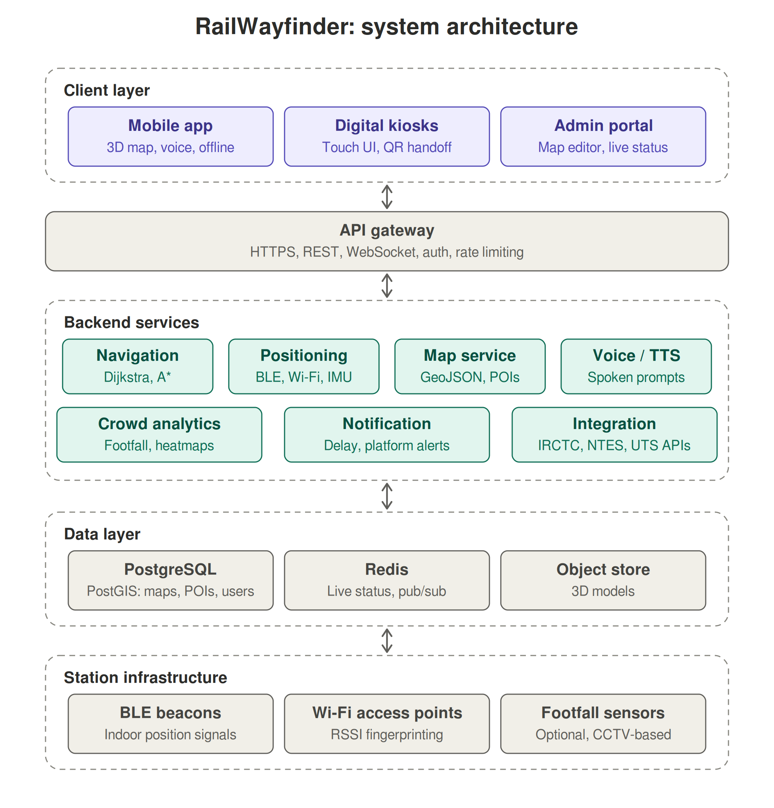
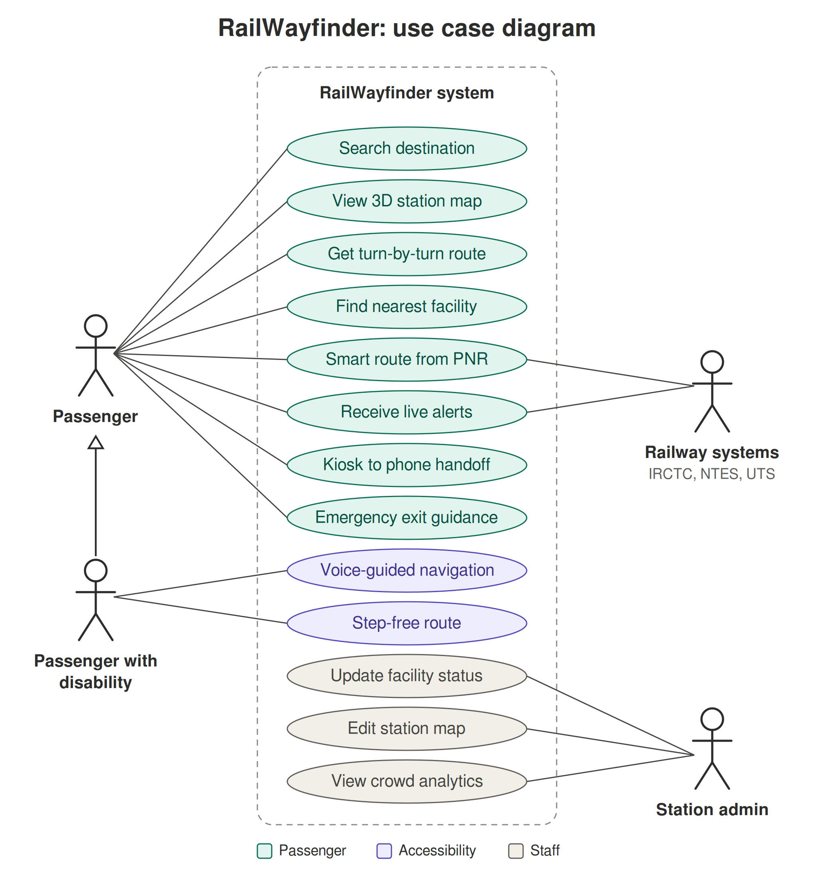

# Smart India Hackathon Workshop
# Date: 30.10.2026
## Register Number: 212224040082
## Name: Divya Lakshmi M
## Problem Title

SIH 1710: Enhancing Navigation for Railway Station Facilities and Locations

## Problem Description

Background: Railway stations are complex environments with numerous facilities and locations such as ticket counters, platforms, restrooms, food courts, and waiting areas. Passengers often face difficulties in navigating these spaces, especially in large or unfamiliar stations. Efficient and user-friendly navigation systems are crucial for improving passenger experience, reducing congestion, and ensuring timely travel connections. Description: The problem involves developing a comprehensive navigation solution for railway stations that assists passengers in locating various facilities and destinations within the station premises. This includes creating detailed maps, providing real-time directions, and integrating features such as accessibility options for individuals with disabilities. The solution should be intuitive, easy to use, and accessible via multiple platforms, including mobile devices and digital kiosks. Key challenges include updating navigation information in real-time, ensuring accuracy, and accommodating the diverse needs of all passengers. Expected Solution: The expected solution is a multi-platform navigation system that provides detailed, real-time directions to all facilities and locations within a railway station. This system should include: A mobile application with 3D interactive maps and step-by-step navigation. Digital kiosks located throughout the station with touch-screen interfaces. Voice-guided navigation for visually impaired passengers. Regular updates to reflect changes in station layout and facility locations. Integration with existing railway apps and services for seamless user experience. The solution should enhance the overall passenger experience by reducing confusion, saving time, and improving accessibility within the station.

## Problem Creater's Organization

Ministry of Railway

## Idea

IDEA

1. Overview
   RailWayfinder is a multi-platform, real-time indoor navigation system for railway stations. It combines a mobile app with 3D interactive maps, touch-screen digital kiosks, and voice-guided navigation for visually impaired passengers.

2. Admin control
   A web-based admin portal lets station staff update layouts and facility status instantly, so the map never goes stale.

3. How it helps passengers
   3.1 Finds the way to platforms, restrooms, food courts, waiting areas, and ticket counters without GPS, using BLE beacons and Wi-Fi.
   3.2 Gives a route from the entrance to the right platform when the passenger enters a PNR or train number.
   3.3 Offers step-free routes, voice guidance, and multilingual support so every passenger can use it.
   3.4 Alerts passengers about delays and platform changes and re-routes them automatically.

4. Unique selling points
   4.1 Works indoors without GPS.
   4.2 Accessible to all passengers, including those with disabilities.
   4.3 One admin source of truth for both kiosks and apps.
   4.4 PNR-based smart routing.
   4.5 Integrates with IRCTC, NTES, and UTS.

## Proposed Solution / Architecture Diagram

1. Client layer
   1.1 Mobile app (Android and iOS) with 3D interactive maps, step-by-step directions, voice guidance, and offline mode.
   1.2 Digital touch-screen kiosks around the station, with a QR code to continue the route on the passenger's phone.
   1.3 Web-based admin portal for staff to edit the map, update facility status, and view usage statistics.

2. API gateway
   2.1 A single secure entry point for all clients over HTTPS, REST, and WebSocket.
   2.2 Handles authentication and rate limiting.

3. Backend services
   3.1 Navigation Service: finds the shortest or accessible route using Dijkstra or A* on a station graph.
   3.2 Positioning Service: locates the passenger indoors using BLE beacons, Wi-Fi signals, and phone motion sensors.
   3.3 Map Management Service: stores floors, facilities, and points of interest in GeoJSON.
   3.4 Voice/TTS Service: produces spoken directions in multiple languages.
   3.5 Crowd Analytics Service: measures footfall and suggests less crowded paths.
   3.6 Notification Service: sends alerts for delays and platform changes.
   3.7 Integration Service: connects to IRCTC, NTES, and UTS for PNR details and live train status.

4. Data layer
   4.1 PostgreSQL with PostGIS: stores maps, facilities, and users.
   4.2 Redis: holds live status and pushes real-time updates to all devices.
   4.3 Object store: holds the 3D models.

5. Station infrastructure
   5.1 BLE beacons and Wi-Fi access points for indoor positioning.
   5.2 Optional CCTV or footfall sensors for crowd analytics.

6. How it works
   6.1 The passenger picks a destination or enters a PNR.
   6.2 The system estimates their indoor location.
   6.3 It calculates the best route, including step-free routes for wheelchair users.
   6.4 The app shows 3D directions and speaks the turns, and re-routes if the passenger goes off course.
   6.5 When staff change something in the admin portal, such as a lift going out of service, every app and kiosk updates instantly.

## Use Case

## Technology Stack

1. Mobile app: Flutter or React Native, with ARCore/ARKit for optional AR navigation. Mapbox or Three.js renders the 3D maps.
2. Kiosk interface: React.js (with Electron) on touch-screen displays.
3. Admin portal: React.js with Leaflet or Mapbox and an indoor map editor.
4. Backend: Node.js (Express) or Spring Boot (Java), using REST APIs and WebSocket for live updates.
5. Routing algorithm: Dijkstra and A* on a weighted station graph, with accessibility constraints such as avoiding stairs.
6. Indoor positioning: BLE beacons (iBeacon/Eddystone), Wi-Fi RSSI fingerprinting, and IMU sensor fusion.
7. Database: PostgreSQL with PostGIS for map and location data, and Redis for real-time state and pub/sub.
8. Voice and language: Google Text-to-Speech and Speech-to-Text, Android TalkBack and iOS VoiceOver support, and translation APIs for regional languages.
9. Map data formats: GeoJSON, IndoorGML, and OpenStreetMap indoor tagging.
10. Cloud and deployment: AWS, Azure, or MeghRaj (Government of India cloud), with Docker and Kubernetes.
11. Security: JWT/OAuth2 authentication, HTTPS/TLS encryption, and role-based access for admins.
12. Analytics: Grafana or Power BI dashboards for crowd and usage insights.
13. Notifications: Firebase Cloud Messaging for push alerts.

## Dependencies

1. Hardware
   1.1 BLE beacons and Wi-Fi access points installed across the station.
   1.2 Touch-screen kiosks placed at key points.
   1.3 Server or cloud infrastructure to host the backend.
   1.4 Optional CCTV or footfall sensors for crowd analytics.

2. Railway data APIs
   2.1 IRCTC for PNR and booking details.
   2.2 NTES for live train running status and platform allocation.
   2.3 UTS for unreserved ticketing integration.

3. Station data
   3.1 CAD or PDF floor plans from Indian Railways to build the digital map and 3D models.
   3.2 A list of facilities and their locations (restrooms, food courts, lifts, ticket counters, waiting areas).

4. Mobile OS features
   4.1 Bluetooth and location permissions for indoor positioning.
   4.2 Accessibility services (TalkBack on Android, VoiceOver on iOS).

5. Third-party services
   5.1 Map SDKs (Mapbox or Leaflet) for map rendering.
   5.2 Google Text-to-Speech and Speech-to-Text for voice guidance.
   5.3 Translation APIs for regional languages.
   5.4 Firebase Cloud Messaging for push notifications.

6. Connectivity
   6.1 Station Wi-Fi or mobile data for live updates.
   6.2 Offline map cache on the phone as a fallback.

7. Stakeholder support
   7.1 Railway station staff to keep facility data up to date through the admin portal.
   7.2 Approval from Indian Railways to install beacons and kiosks.

8. Regulatory compliance
   8.1 India's Digital Personal Data Protection (DPDP) Act for user data privacy.
   8.2 WCAG 2.1 accessibility guidelines.
   8.3 Rights of Persons with Disabilities (RPwD) Act.